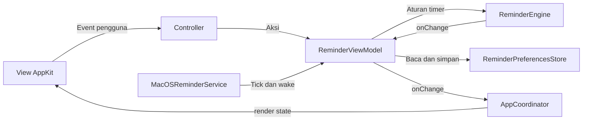

# Arsitektur MVVM Tegak

`ReminderEngine` menjalankan aturan timer. `ReminderViewModel` menerima aksi pengguna dan mengubah hasil Model menjadi state untuk UI. View merender state tersebut; controller AppKit meneruskan klik, input, dan event keyboard ke ViewModel.

## Struktur

```text
Sources/
├── TegakCore/
│   ├── Models/
│   │   └── ReminderEngine.swift
│   ├── ViewModels/
│   │   ├── ReminderViewModel.swift
│   │   └── ReminderViewState.swift
│   └── Services/
│       └── ReminderPreferencesStore.swift
└── Tegak/
    ├── Application/
    │   ├── App.swift
    │   ├── AppDelegate.swift
    │   └── AppCoordinator.swift
    ├── Views/
    │   ├── SettingsView.swift
    │   ├── IslandView.swift
    │   └── Components.swift
    ├── Controllers/
    │   ├── SettingsWindowController.swift
    │   ├── IslandWindowController.swift
    │   └── MenuBarController.swift
    ├── Services/
    │   └── MacOSReminderService.swift
    └── Diagnostics/
        └── SmokeTestRunner.swift
```

## Alur data



Satu instance ViewModel dipakai pengaturan, island, dan menu bar agar ketiganya memperlihatkan timer yang sama. Binding menggunakan callback `onChange`; `AppCoordinator` meneruskan perubahan ke renderer ketiga tampilan. Tidak ada dependency framework tambahan.

## Tanggung jawab

**Model:** `ReminderEngine` menyimpan deadline, sisa waktu saat jeda, serta state idle/running/paused/reminding. Ia menangani mulai, jeda, pengakuan pengingat, tunda, dan wake. Model tidak mengenal window, warna, atau teks tombol.

**ViewModel:** `ReminderViewModel` memiliki Model dan menerima `ReminderPreferencesStore`. Ia menangani validasi menit, draft input yang sedang diedit, penyimpanan pilihan, aksi timer, ekspansi island, dan format countdown. Properti `settings`, `island`, dan `menuBar` mengeluarkan struct state dengan nilai immutable. ViewModel hanya memakai Foundation.

**View:** `SettingsView` dan `IslandView` mengatur layout serta warna dan menerima state lewat `render`. View tidak membaca UserDefaults atau memanggil Model. `Components.swift` memuat komponen gambar, tombol, label, dan tipe window bersama.

**Controller:** controller menghubungkan target-action, editor teks, fokus keyboard, presentasi window, dan posisi panel terhadap layar. Perhitungan notch memakai AppKit sehingga berada di `IslandWindowController`. Teks dan keputusan state timer berasal dari ViewModel.

**Application:** `AppDelegate` menangani launch, reopen, dan termination. `AppCoordinator` menyusun controller dan binding serta menghubungkan permintaan navigasi dan event platform. Keduanya tidak memvalidasi interval atau menghitung deadline.

**Services:** `UserDefaultsReminderPreferences` mengimplementasikan kontrak preferensi. `MacOSReminderService` menangani Timer, notifikasi wake/perubahan layar, dan suara. `onRequestSettings` dan `onPlayReminderSound` menghubungkan kebutuhan ViewModel ke integrasi macOS tanpa mengimpor AppKit ke core.

## Lokasi perubahan

| Perubahan | File utama |
| --- | --- |
| Aturan deadline, jeda, atau tunda | `TegakCore/Models/ReminderEngine.swift` |
| Validasi input, teks state, atau aksi pengguna | `TegakCore/ViewModels/ReminderViewModel.swift` |
| Bentuk state untuk tampilan | `TegakCore/ViewModels/ReminderViewState.swift` |
| Penyimpanan interval dan suara | `TegakCore/Services/ReminderPreferencesStore.swift` |
| Layout pengaturan atau island | `Tegak/Views/SettingsView.swift`, `IslandView.swift` |
| Posisi notch dan pengelolaan window | `Tegak/Controllers/` |
| Event sistem macOS | `Tegak/Services/MacOSReminderService.swift` |

## Pengujian

```sh
zsh scripts/test.sh
zsh scripts/test.sh --ui
```

Tes engine memeriksa aturan timer. Tes ViewModel memakai preferensi dalam memori dan jam yang diinjeksi agar bisa memeriksa draft input, validasi, deadline, perubahan state, routing, dan permintaan suara tanpa AppKit. Smoke test menjalankan kontrol View dan controller asli melalui coordinator yang sama dengan aplikasi, dengan jam uji tanpa mengganti Model saat aplikasi berjalan.

Render delapan state UI dibandingkan dengan file preview sebelum refactor. Pemeriksaan ini membedakan refactor struktur dari perubahan tampilan; pengujian desktop fisik tetap mengikuti batas yang dijelaskan di README.
